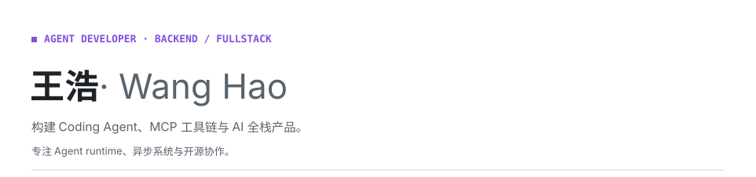
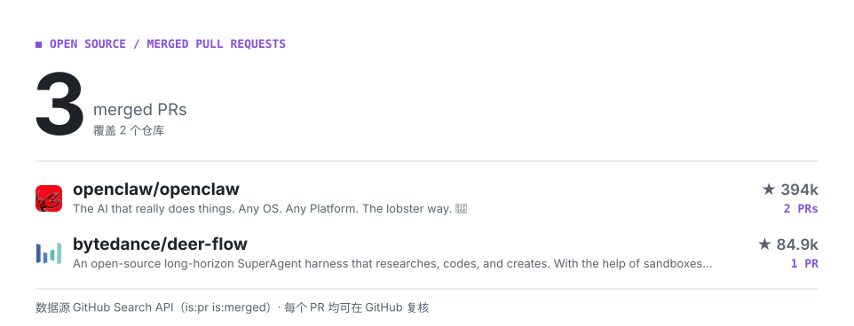

<picture>
  <source media="(prefers-color-scheme: dark)" srcset="./assets/hero-dark.svg">
  
</picture>

<!-- CONTRIB:BEGIN -->
<picture>
  <source media="(prefers-color-scheme: dark)" srcset="./assets/contrib-dark.svg">
  
</picture>
<!-- CONTRIB:END -->

## 代表作品

- **[Blog](<https://github.com/67-luck/Blog>)**：支持 AI 摘要、流式回答和多模型回退的博客系统。
- **[Folio](<https://github.com/67-luck/folio>)**：本地优先的 AI 原生投资研究工作台。
- **[DeerFlow](<https://github.com/67-luck/deer-flow>)**：面向子 Agent、记忆、沙箱和技能的 Agent harness。
- **[OpenClaw](<https://github.com/67-luck/openclaw>)**：参与 Gateway、调度、插件与模型流边界的可靠性改进。
- **[FastMCP](<https://github.com/67-luck/fastmcp>)**：参与 MCP OAuth、Prompt 渲染与上下文问题修复。
- **[Octop](<https://github.com/67-luck/Octop>)**：面向多用户、多 Agent 的自托管 AI 助手。

## 更多信息

[GitHub](<https://github.com/67-luck>) · [博客](<https://www.cqytxy.edu.cn/>)

